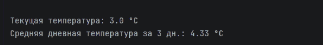

# Сервис метеоданных

Приложение получает прогноз через API Яндекс Погоды и выводит результат в консоль.

## Результат запуска

1 ноября 2026 года, Москва (55.75, 37.62), прогноз на 3 дня.

- Текущая температура: **3.0 °C**
- Средняя дневная температура за 3 дня: **4.33 °C**
- Запрос выполнен успешно, код завершения: **0**

